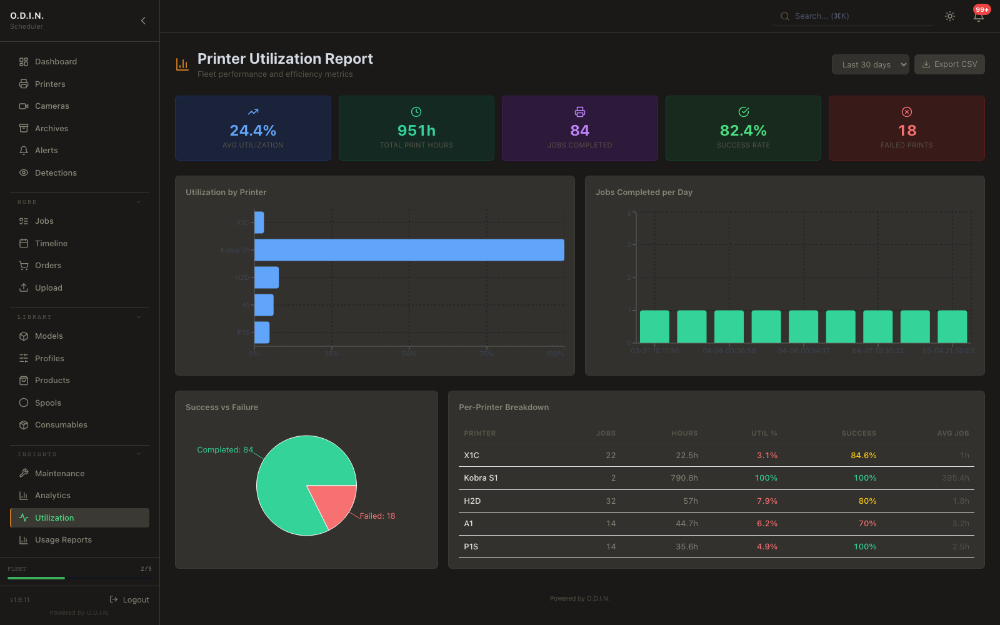
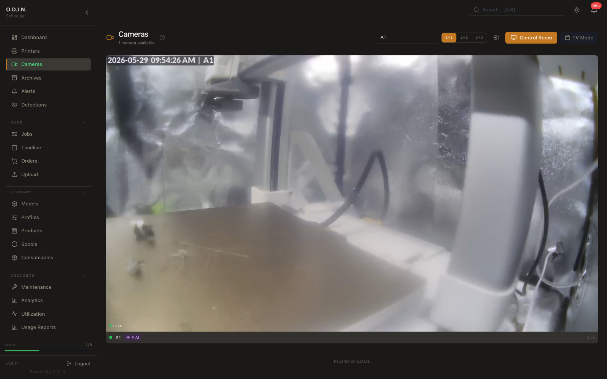

<div align="center">

# O.D.I.N.

**Self-hosted 3D print farm management**

[](https://github.com/HughKantsime/runsodin/releases)
[](LICENSE)
[](https://github.com/HughKantsime/runsodin/actions/workflows/ci.yml)
[](https://github.com/HughKantsime/runsodin/pkgs/container/odin)
[](https://runsodin.com)
[](https://github.com/HughKantsime/runsodin/stargazers)

[Website](https://runsodin.com) · [Install](https://runsodin.com/install) · [Features](https://runsodin.com/features) · [Pricing](https://runsodin.com/pricing)

</div>

---

Self-hosted print farm management that combines multi-protocol printer support, AI failure detection, and business operations in a single container. No cloud dependency. No per-printer fees. Files, camera processing and records are hosted on your server; enabled integrations may transmit selected data.

## Key Features

- **Multi-Protocol Fleet** — Klipper printers running Moonraker, PrusaLink, Bambu MQTT (X1C, P1S, A1, H2D), Elegoo SDCP, and Anycubic LAN mode (monitoring only) from one dashboard
- **Vigil AI Failure Detection** — ONNX-based spaghetti detection is bundled; first-layer and detachment detection need an uploaded, activated model, and empty-plate has a built-in image check that is off by default and runs only while the printer is idle. Auto-pause is off by default
- **Smart Job Scheduling** — Color-match scoring, time-window matching, drag-and-drop queue
- **Mid-Print Controls** — Skip objects, adjust speed (25%–200%), and clear HMS errors during active prints (Bambu printers only)
- **Print Archive** — Auto-captures every completed print with metadata, thumbnails, and searchable history
- **OBS Streaming Overlay** — Auth-free `/overlay/:printerId` page for live streaming with camera, progress, and temps
- **Order-to-Ship Workflow** — Products, BOM, orders, invoicing, cost tracking, and shipping in one system
- **WebRTC Camera Streaming** — Live feeds via go2rtc with control room mode, PiP, and timelapse capture
- **Spool Inventory** — Filament tracking with QR labels, AMS integration, PA profiles, low-stock alerts, bidirectional Spoolman sync (pull inventory + push consumption), and CSV export
- **Notifications** — Discord, Slack, Telegram, ntfy, WhatsApp, Pushover, email, and browser push
- **Enterprise Security** — RBAC (admin/operator/viewer), TOTP MFA, Microsoft Entra ID SSO, IP allowlisting, audit logs
- **Native Companion Apps** — iOS, iPadOS, and macOS apps with fleet view, widgets, and Live Activities ([odin-native](https://github.com/HughKantsime/odin-native))
- **Single Container Deploy** — One `docker compose up`, ~256 MB RAM, all 9 services included

## Quick Install

**Linux / macOS:**

```bash
curl -fsSL https://raw.githubusercontent.com/HughKantsime/runsodin/main/install/install.sh | bash
```

**Windows (PowerShell):**

```powershell
irm https://raw.githubusercontent.com/HughKantsime/runsodin/main/install/install.ps1 | iex
```

See [Windows Installation Guide](install/WINDOWS_INSTALL.md) for detailed instructions.

**Or with Docker Compose directly:**

```bash
mkdir odin && cd odin
curl -O https://raw.githubusercontent.com/HughKantsime/runsodin/main/install/docker-compose.yml
docker compose up -d
```

Open `http://your-server-ip:8000` and follow the setup wizard.

## Screenshots

### Fleet Overview


### Camera Streaming

Bambu P1P, P1S, A1 and A1 Mini built-in cameras are auto-detected when printer credentials are configured and the camera is enabled. Leave Camera URL blank, or set a URL to use an external camera instead. These built-in cameras deliver about one frame every two seconds. ODIN shares one of the printer's two camera connections across all viewers, leaving the other available for Bambu Handy or Studio.



## How it differs

- **Self-hosted.** You run O.D.I.N. on your own server (Docker). Files, camera processing and records are hosted on your server; enabled integrations may transmit selected data. It sends no telemetry and has no update checker. The server contacts outside services only for integrations an admin sets up and for license actions (activate, unactivate, reactivate, trial request), which can also be done offline: the server stays offline and another internet-connected device uses the license portal. Browser push notifications contact the browser vendor's push service once a user subscribes, and opening a live camera view in a browser currently contacts Google's STUN server.
- **Five printer families.** Bambu Lab (local MQTT), Klipper printers running Moonraker, Prusa (PrusaLink), Elegoo (SDCP) and Anycubic (LAN mode). Job sending works for Bambu, Moonraker and PrusaLink printers; Elegoo printers get monitoring plus pause, resume and stop, and Anycubic printers are monitoring only. A Kobra printer set up as Moonraker is refused for job sending.
- **Flat pricing.** Community is free (5 printers, 1 user). Pro is $15 per month or $150 per year with unlimited printers and users, orders, analytics and single sign-on. Education is quoted per site; Enterprise is custom.
- **Failure detection included.** Vigil AI works from camera images on FDM printers. Its bundled spaghetti model is [Obico](https://www.obico.io/)'s published model (AGPL-3.0); first-layer and detachment detection need an uploaded, activated model, and empty-plate has a built-in image check that is off by default and runs only while the printer is idle.

For how O.D.I.N. compares with hosted print-farm services, see [runsodin.com/compare](https://runsodin.com/compare).

## Stack

- **Backend** — Python 3.11, FastAPI, SQLAlchemy, SQLite (WAL mode)
- **Frontend** — React 18, Vite, TailwindCSS, React Query
- **Streaming** — go2rtc (WebRTC, RTSP)
- **AI** — ONNX Runtime (Vigil AI failure detection)
- **Deploy** — Docker, supervisord (9 managed processes)

## Agents (v1.8.9+)

O.D.I.N. speaks [Model Context Protocol](https://modelcontextprotocol.io) natively. Drive the farm from Claude Desktop, Claude Code, OpenClaw, or any MCP-compatible client — with idempotent retries, dry-run previews, structured error codes, and a local-LLM deployment path designed for ITAR/CMMC environments.

- **[odin-print-farm-mcp](https://github.com/HughKantsime/odin-mcp)** (npm: `odin-print-farm-mcp@2`) — 26 tools covering queue, printers, jobs, inventory, alerts, maintenance.
- **[MCP integration docs](https://docs.runsodin.com/integrations/mcp-server)** — Quick start, tool catalog, agent primitives, error codes.
- **[ITAR / CMMC mode](https://docs.runsodin.com/configuration/itar-mode)** — Fail-closed air-gap deployment.

## Documentation

- [Private remote access with Tailscale](docs/REMOTE_ACCESS.md) — HTTPS for web/API, with camera TCP transport and snapshot fallback.

- [Full Documentation](https://docs.runsodin.com) — Installation, configuration, features, API reference, troubleshooting
- [Install Guide](https://runsodin.com/install) — Setup, configuration, and updating
- [Features](https://runsodin.com/features) — Full feature catalog
- [Pricing](https://runsodin.com/pricing) — Community, Pro, Education, Enterprise tiers
- [API Docs](https://runsodin.com) — Swagger UI at `/api/docs` on your running instance
- [Read-only external filament display](docs/filament-ledger-display.md) — Optional external tool-to-spool mapping feed; linked printers cannot use AMS sync or hardware slot/Bambu configuration (HTTP 409)
- [CHANGELOG](CHANGELOG.md) — Version history
- [SECURITY](SECURITY.md) — Security policy and vulnerability reporting

## Community

- [Discord](https://discord.gg/odin-community) — Support and discussion
- [GitHub Issues](https://github.com/HughKantsime/runsodin/issues) — Bug reports and feature requests
- [runsodin.com](https://runsodin.com) — Website and documentation

## Contributing

Contributions are welcome — bug reports, feature requests, docs fixes, and PRs. See [CONTRIBUTING.md](CONTRIBUTING.md) for the full guide.

- **File a bug** — open a [GitHub issue](https://github.com/HughKantsime/runsodin/issues/new) with steps to reproduce
- **Request a feature** — describe the problem first, then your proposed solution
- **Submit a PR** — fork, branch off `main`, run tests, and open the PR
- **Help others** — answer questions on [Discord](https://discord.gg/odin-community) or in GitHub issues
- **Star the repo** — it helps new operators find the project

For security vulnerabilities, please follow the disclosure process in [SECURITY.md](SECURITY.md).

## License

O.D.I.N. is licensed under the [Business Source License 1.1](LICENSE). Source-available, not open source.

- **Free** for personal and non-commercial use (Community tier: 5 printers, 1 user)
- **Commercial use** requires a paid license (Pro, Education, or Enterprise)
- **On 2029-02-07** the license converts to Apache 2.0

License keys are verified locally with Ed25519 signatures. ODIN sends no telemetry and has no update checker. Optional online license actions (activate, unactivate, reactivate, trial request) contact the license portal and can also be done offline: the server stays offline and another internet-connected device uses the portal. No cloud dependency.

---

<div align="center">

**[runsodin.com](https://runsodin.com)**

Built by [Sublab 3DP](https://runsodin.com)

</div>

### Browser support

ODIN v1.9.18 and later requires Safari 16.4+, Chrome/Chromium 111+, or
Firefox 128+ for the frontend. Update older managed browsers before upgrading.
See [browser support and migration notes](docs/FRONTEND_BROWSER_SUPPORT.md).

### Preserving paid license identity

Device-bound paid licenses require the original `.odin-install-id` and `.odin-device.key` in `LICENSE_DIR` (normally `/data`). Preserve both with `odin.license` in a separate encrypted host backup, with the private key owned by the ODIN account and mode `0600`. Database restores and portable exports alone do not transfer this identity. Never include the private key in support bundles. For transfers and lost-key recovery, follow the [backup and restore runbook](docs/BACKUP_RESTORE_RUNBOOK.md#paid-license-identity-and-recovery). Legacy paid files keep their existing validation rules; conversion is voluntary and purchase-wide.
