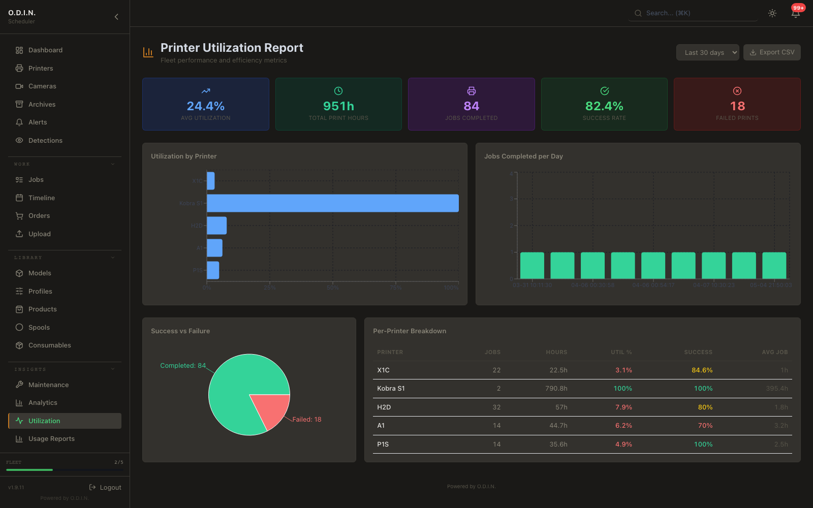
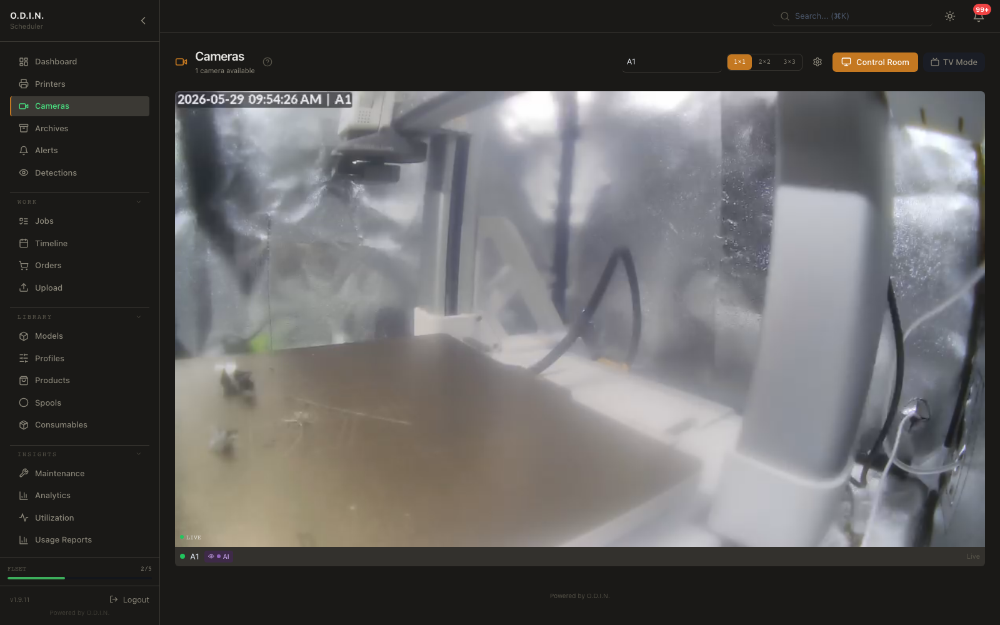

<div align="center">

# O.D.I.N.

**Self-hosted 3D print farm management**

[](https://github.com/HughKantsime/runsodin/releases)
[](LICENSE)
[](https://github.com/HughKantsime/runsodin/actions/workflows/ci.yml)
[](https://github.com/HughKantsime/runsodin/pkgs/container/odin)
[](https://runsodin.com)
[](https://github.com/HughKantsime/runsodin/stargazers)

[Website](https://runsodin.com) · [Install](https://runsodin.com/install) · [Features](https://runsodin.com/features) · [Pricing](https://runsodin.com/pricing)

</div>

---

Self-hosted print farm management that combines multi-protocol printer support, AI failure detection, and business operations in a single container. No per-printer fees. Files, camera processing and records are hosted on your server, and O.D.I.N. runs without any cloud service; activating a license online contacts runsodin.com (or activate by file), and enabled integrations may transmit selected data.

## Key Features

- **Multi-Protocol Fleet** — Bambu MQTT (X1C, P1S, A1, H2D), Moonraker, PrusaLink, Elegoo SDCP, Anycubic LAN, OctoPrint and Ultimaker from one dashboard; sending restrictions are described below
- **Vigil AI Failure Detection** — ONNX-based spaghetti detection is bundled; first-layer and detachment detection need an uploaded, activated model, and empty-plate has a built-in image check that is off by default and runs only while the printer is idle. Auto-pause is off by default
- **Smart Job Scheduling** — Color-match scoring, time-window matching, drag-and-drop queue
- **Mid-Print Controls** — Skip objects, adjust speed (Silent, Standard, Sport or Ludicrous), and clear HMS errors during active prints (Bambu printers only)
- **Print Archive** — Automatically archives terminal physical print attempts with metadata, thumbnails, and searchable history; completing a queue job without a recorded physical attempt does not create an archive
- **OBS Streaming Overlay** — Auth-free `/overlay/:printerId` page for live streaming with camera, progress, and temps
- **Order-to-Ship Workflow** — Products, BOM, orders, invoicing, cost tracking, and shipping in one system
- **WebRTC Camera Streaming** — Live feeds via go2rtc with control room mode, PiP, and timelapse capture
- **Spool Inventory** — Filament tracking with QR labels, AMS integration, PA profiles, low-stock alerts, bidirectional Spoolman sync (pull inventory + push consumption), and CSV export
- **Notifications** — Discord, Slack, Telegram, ntfy, WhatsApp, Pushover, email, and browser push
- **Security** — TOTP MFA, IP allowlisting and an audit log on every tier; roles (admin/operator/viewer) and single sign-on (Microsoft Entra ID, Google Workspace or any OpenID Connect provider) in Pro and up; audit export, integrity verification, SIEM streaming and traceability in Enterprise
- **Native Companion Apps** — iOS and iPadOS apps with fleet view; macOS coming soon ([odin-native](https://github.com/HughKantsime/odin-native))
- **Single Container Deploy** — One `docker compose up`; the backend, printer monitors and support processes run under one supervisor

## Quick Install

**Linux / macOS:**

```bash
curl -fsSL https://raw.githubusercontent.com/HughKantsime/runsodin/main/install/install.sh | bash
```

**Windows (PowerShell):**

```powershell
irm https://raw.githubusercontent.com/HughKantsime/runsodin/main/install/install.ps1 | iex
```

See [Windows Installation Guide](install/WINDOWS_INSTALL.md) for detailed instructions.

**Or with Docker Compose directly:**

```bash
mkdir odin && cd odin
curl -O https://raw.githubusercontent.com/HughKantsime/runsodin/main/install/docker-compose.yml
docker compose up -d
```

Open `http://your-server-ip:8000` and follow the setup wizard.

## Screenshots

### Fleet Overview


### Camera Streaming

Bambu P1P, P1S, A1 and A1 Mini built-in cameras are auto-detected when printer credentials are configured and the camera is enabled. Leave Camera URL blank, or set a URL to use an external camera instead. These built-in cameras deliver about one frame every two seconds. ODIN shares one of the printer's two camera connections across all viewers, leaving the other available for Bambu Handy or Studio.



## How it differs

- **Self-hosted.** You run O.D.I.N. on your own server (Docker). Files, camera processing and records are hosted on your server; enabled integrations may transmit selected data. O.D.I.N. sends no vendor telemetry; configured integrations can transmit telemetry and events. It has no update checker. The server contacts outside services for integrations an admin sets up and for license actions. Activation, trial requests and unactivation support offline exchange: the server stays offline and another internet-connected device uses the license portal; reactivation/re-checking requires a connection from O.D.I.N. An administrator can also request a cached license-server reachability check through `GET /api/system/license-server-status`. The web app does not call it and no background task schedules it. The check sends no installation data; the portal sees the connecting IP address. Once users subscribe, the ODIN server sends browser push notifications to the push providers. WebRTC camera views use local network candidates only and contact no public STUN server.
- **Printer integrations.** Bambu Lab (local MQTT), Klipper printers running Moonraker, Prusa (PrusaLink), Elegoo SDCP, Anycubic LAN, OctoPrint and Ultimaker. Job sending works for Bambu, Moonraker and PrusaLink; Elegoo and OctoPrint sending require per-printer Experimental opt-in. Moonraker Kobra S1 sending requires `ODIN_KOBRA_S1_SENDING=1` and attended dispatch; Kobra 3 sending remains refused. Anycubic LAN and Ultimaker are monitoring-only.
- **Flat pricing.** Community is free (5 printers, 1 user), including the cost calculator and pricing configuration. Pro is $15 per month or $150 per year with unlimited printers and users, orders, analytics and single sign-on. Education is quoted per site; Enterprise is custom.
- **Failure detection included.** Vigil AI works from camera images on FDM printers. Its bundled spaghetti model is [Obico](https://www.obico.io/)'s published model, licensed under AGPL-3.0 (see [NOTICE.txt](backend/vision_models_default/NOTICE.txt) and the [source mirror](https://github.com/HughKantsime/runsodin/releases/tag/third-party/obico-model-1e7abb0b)); first-layer and detachment detection need an uploaded, activated model, and empty-plate has a built-in image check that is off by default and runs only while the printer is idle.

For how O.D.I.N. compares with hosted print-farm services, see [runsodin.com/compare](https://runsodin.com/compare).

## Stack

- **Backend** — Python 3.11, FastAPI, SQLAlchemy, SQLite (WAL mode, default) or PostgreSQL
- **Frontend** — React 18, Vite, TailwindCSS, React Query
- **Streaming** — go2rtc (WebRTC, RTSP)
- **AI** — ONNX Runtime (Vigil AI failure detection)
- **Deploy** — Docker, supervisord managing the backend, printer monitors and support processes

## Agents (v1.8.9+)

O.D.I.N. speaks [Model Context Protocol](https://modelcontextprotocol.io) natively. Drive the farm from Claude Desktop, Claude Code, OpenClaw, or any MCP-compatible client — with safe retries (a repeated write with the same key runs once; on current and earlier releases this needs an API token without an expiry date), dry-run previews, structured error codes, and a local-model deployment path that can run on-premises with ITAR mode on.

- **[odin-print-farm-mcp](https://github.com/HughKantsime/odin-mcp)** (npm: `odin-print-farm-mcp@2`) — tools covering queue, printers, jobs, inventory, alerts and maintenance; see the package for the current list.
- **[MCP integration docs](https://docs.runsodin.com/integrations/mcp-server)** — Quick start, tool catalog, agent primitives, error codes.
- **[ITAR mode](https://docs.runsodin.com/configuration/itar-mode)** — In release 2.2.0, ITAR mode refuses public addresses in its webhook, license, roster, SIEM and mail clients, its MQTT republish client, and selected printer requests, including OctoPrint and Ultimaker; keep printers and cameras on private addresses. A public identity provider requires an explicit allow-list entry.

## Documentation

- [Private remote access with Tailscale](docs/REMOTE_ACCESS.md) — HTTPS for web/API, with camera TCP transport and snapshot fallback.

- [Full Documentation](https://docs.runsodin.com) — Installation, configuration, features, API reference, troubleshooting
- [Install Guide](https://runsodin.com/install) — Setup, configuration, and updating
- [Features](https://runsodin.com/features) — Full feature catalog
- [Pricing](https://runsodin.com/pricing) — Community, Pro, Education, Enterprise tiers
- [API Docs](https://runsodin.com) — Swagger UI at `/api/docs` on your running instance
- [Read-only external filament display](docs/filament-ledger-display.md) — Optional external tool-to-spool mapping feed; linked printers cannot use AMS sync or hardware slot/Bambu configuration (HTTP 409)
- [CHANGELOG](CHANGELOG.md) — Version history
- [SECURITY](SECURITY.md) — Security policy and vulnerability reporting

## Community

- Email [support@runsodin.com](mailto:support@runsodin.com) — Support, licenses and sales
- [GitHub Issues](https://github.com/HughKantsime/runsodin/issues) — Bug reports and feature requests
- [runsodin.com](https://runsodin.com) — Website and documentation

## Contributing

Contributions are welcome — bug reports, feature requests, docs fixes, and PRs. See [CONTRIBUTING.md](CONTRIBUTING.md) for the full guide.

- **File a bug** — open a [GitHub issue](https://github.com/HughKantsime/runsodin/issues/new) with steps to reproduce
- **Request a feature** — describe the problem first, then your proposed solution
- **Submit a PR** — fork, branch off `main`, run tests, and open the PR
- **Help others** — answer questions in GitHub issues
- **Star the repo** — it helps new operators find the project

For security vulnerabilities, please follow the disclosure process in [SECURITY.md](SECURITY.md).

## License

O.D.I.N. is licensed under the [Business Source License 1.1](LICENSE). Source-available, not open source.

- **Free** for personal and non-commercial use (Community tier: 5 printers, 1 user)
- **Commercial use** requires a paid license (Pro, Education, or Enterprise)
- **On 2029-02-07** the license converts to Apache 2.0

License keys are verified locally with Ed25519 signatures. O.D.I.N. sends no vendor telemetry; configured integrations can transmit telemetry and events. It has no update checker. Optional online license actions contact the license portal. Activation, trial requests and unactivation support offline exchange: the server stays offline and another internet-connected device uses the license portal; reactivation/re-checking requires a connection from O.D.I.N. No cloud dependency.

---

<div align="center">

**[runsodin.com](https://runsodin.com)**

Built by [Sublab 3DP](https://runsodin.com)

</div>

### Browser support

ODIN v1.9.18 and later requires Safari 16.4+, Chrome/Chromium 111+, or
Firefox 128+ for the frontend. Update older managed browsers before upgrading.
See [browser support and migration notes](docs/FRONTEND_BROWSER_SUPPORT.md).

### Preserving paid license identity

Device-bound paid licenses require the original `.odin-install-id` and `.odin-device.key` in `LICENSE_DIR` (normally `/data`). Preserve both with `odin.license` in a separate encrypted host backup, with the private key owned by the ODIN account and mode `0600`. Database restores and portable exports alone do not transfer this identity. Never include the private key in support bundles. For transfers and lost-key recovery, follow the [backup and restore runbook](docs/BACKUP_RESTORE_RUNBOOK.md#paid-license-identity-and-recovery). Legacy paid files keep their existing validation rules; conversion is voluntary and purchase-wide.
